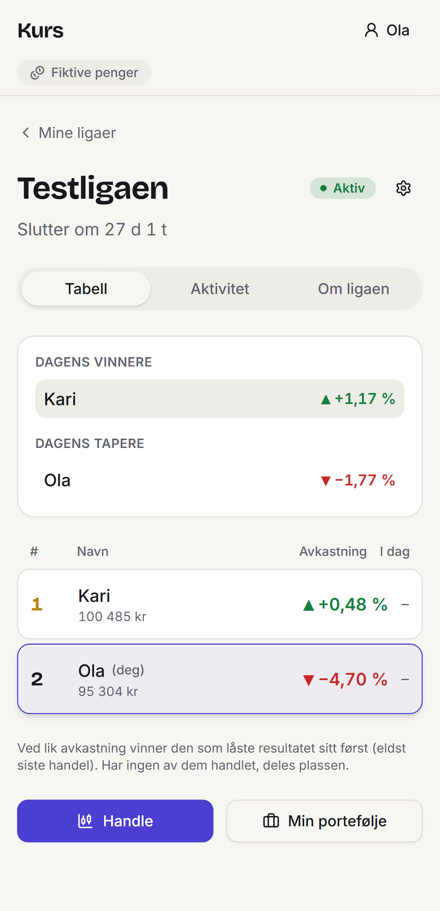
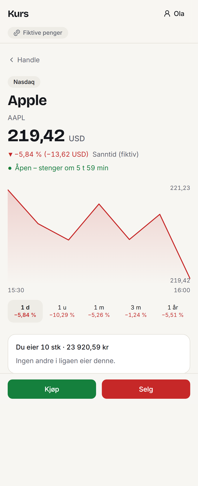
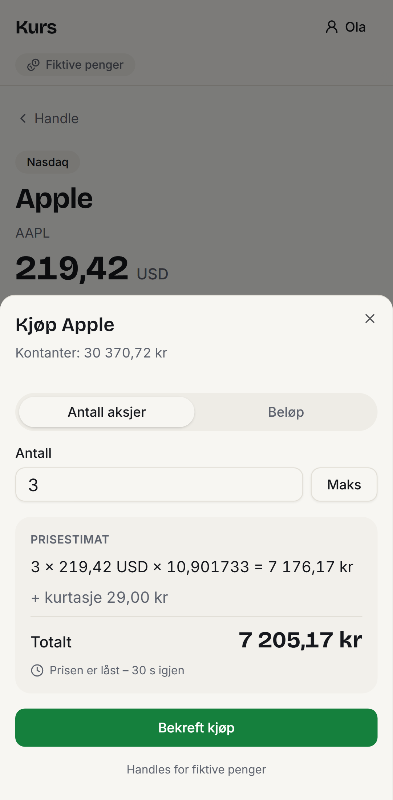

# Kurs

En app der venner konkurrerer i ligaer ved å handle ekte aksjer med **fiktive penger**.

Du lager en liga, inviterer venner med en kode og bestemmer reglene: valuta, startsum, start- og sluttdato, kurtasje, hvilke børser som er tillatt og hvor stor andel én aksje kan utgjøre. Alle starter likt og handler på Oslo Børs, Stockholm, København, Nasdaq og NYSE. Ledertabellen rangerer på avkastning i prosent, og når ligaen er slutt, fryses resultatet og en vinner kåres.

<p>
  <picture>
    <source media="(prefers-color-scheme: dark)" srcset="docs/skjermbilder/dark-02-league-table.png">
    
  </picture>
  <picture>
    <source media="(prefers-color-scheme: dark)" srcset="docs/skjermbilder/dark-07-stock.png">
    
  </picture>
  <picture>
    <source media="(prefers-color-scheme: dark)" srcset="docs/skjermbilder/dark-08-trade-sheet.png">
    
  </picture>
</p>

<sub>Ledertabellen, en aksjeside og et kjøp med låst pris. Kursene på bildene er oppdiktede, fra mock-provideren.</sub>

## Status

| Fase | Innhold                                                                           | Status      |
| ---- | --------------------------------------------------------------------------------- | ----------- |
| 0–1  | Analyse, design, monorepo og verktøy                                              | ✅ Ferdig   |
| 2    | Forretningslogikk i `packages/core`, med tester                                   | ✅ Ferdig   |
| 3    | Database, migrasjoner, sikkerhet (RLS) og testdata                                | ✅ Ferdig   |
| 4    | Webappen: innlogging, ligaer, handel, portefølje og verktøy for ligaeieren        | ✅ Ferdig   |
| 5    | Bakgrunnsjobber: splitt og utbytte, avslutning av liga og daglige snapshots       | ✅ Ferdig   |
| 6    | Ekte aksjekurser (i dag brukes realistiske, oppdiktede kurser bak et grensesnitt) | ⏳ Neste    |
| 7    | Publisering på Vercel og Supabase Cloud, så venner kan spille                     | ⏳ Planlagt |

## Det tekniske jeg er mest fornøyd med

Appen håndterer «penger», og det er lett å gjøre feil med penger i kode. Derfor er noen regler ufravikelige:

- **Aldri flyttall for penger.** Beløp, kurser, valutakurser og antall er `decimal.js` i TypeScript og `numeric` i Postgres. Avrunding (halv opp) skjer bare når et beløp bokføres eller vises, og databasen avviser for mange desimaler i stedet for å runde av i stillhet.
- **Serveren bestemmer prisen.** Nettleseren sender bare aksje, kjøp/salg og antall. Serveren lager et pristilbud som gjelder i 30 sekunder og bare kan brukes én gang.
- **Hver handel er atomisk.** Én databasetransaksjon, radlås på medlemmet (`SELECT … FOR UPDATE`) og en idempotensnøkkel. Et dobbeltklikk eller to samtidige kjøp kan aldri bruke de samme pengene to ganger. Dette er bevist med en egen samtidighetstest.
- **Transaksjoner er sannheten.** Kjøp, salg, gebyrer, utbytte og splitter er hendelser som bare kan legges til. En databasetrigger blokkerer endring og sletting. Beholdning og kontanter kan alltid bygges opp på nytt fra hendelsene.
- **Sikkerhet i databasen, ikke bare i grensesnittet.** Hvem som kan se hvem sin portefølje, er én funksjon i `core` og samme regel i SQL (Row Level Security). En test sjekker at de to alltid er enige.
- **Tid og børser.** All tid lagres i UTC. Åpningstider, helligdager og halve dager er definert i børsens egen tidssone, og testene dekker blant annet uka der Europa og USA har byttet til sommertid på ulike datoer.
- **Ren forretningslogikk.** All logikk ligger i `packages/core`, som er ren TypeScript uten I/O (håndhevet med ESLint). Den kan testes isolert og gjenbrukes i en mobilapp senere.
- **Jobber som tåler å kjøres flere ganger.** Splitter, utbytte, avslutning av ligaer og snapshots kjøres av cron over HTTP og gir samme resultat om de kjøres to ganger.
- **Testet på flere nivåer:** enhetstester (Vitest), integrasjonstester mot en ekte Postgres, og ende-til-ende-tester i nettleseren (Playwright) som går gjennom innlogging, liga, invitasjon, handel og kåring av vinner.

**Teknologi:** TypeScript (strict), Next.js (App Router), Tailwind CSS, shadcn/ui, PostgreSQL via Supabase (Auth og RLS), Drizzle ORM, Luxon, decimal.js, Vitest, Playwright, pnpm og Turborepo.

## Hvordan appen er laget

Jeg har laget appen med [Claude Code](https://claude.com/claude-code) som utviklingsverktøy. Min rolle har vært produkteier og arkitekt:

- Jeg skrev [kravspesifikasjonen](docs/oppdrag.md) med produktregler, tekniske prinsipper og en plan i faser.
- Jeg godkjente planen for hver fase før arbeidet startet. Ingenting ble committet uten at jeg sa ja.
- Avklaringer og valg underveis er skrevet ned i [`docs/decisions.md`](docs/decisions.md), og reglene AI-en må følge, i [`CLAUDE.md`](CLAUDE.md).

Det viktigste jeg har lært, er at AI skriver kode raskt, men at kvaliteten avhenger av tydelige krav, faste regler og tester som sjekker at reglene holder.

## Dokumentasjon

| Dokument                                   | Les den når du vil vite …                                                                                                                                 |
| ------------------------------------------ | --------------------------------------------------------------------------------------------------------------------------------------------------------- |
| [`docs/arkitektur.md`](docs/arkitektur.md) | **hvordan appen fungerer i dag**: delene, et kjøp fra start til slutt, penger og valuta, synlighet og sikkerhet, kurser, jobber og datamodell. Start her. |
| [`docs/oppdrag.md`](docs/oppdrag.md)       | hva vi skal bygge, og fasene (kilden til sannhet for produktet)                                                                                           |
| [`docs/decisions.md`](docs/decisions.md)   | hvorfor noe er som det er: alle avklaringer og valg, i tidsrekkefølge                                                                                     |
| [`docs/design.md`](docs/design.md)         | farger, typografi, komponenter og hva vi tok med fra Nordnet                                                                                              |
| [`CLAUDE.md`](CLAUDE.md)                   | reglene og konvensjonene Claude Code jobber etter (på engelsk)                                                                                            |

## Krav

| Verktøy        | Versjon | Merknad                           |
| -------------- | ------- | --------------------------------- |
| Node.js        | 24      | Se `.nvmrc`                       |
| pnpm           | 12      | Aktiveres med corepack (se under) |
| Docker Desktop | nyeste  | Må kjøre for lokal Supabase       |

## Kom i gang

```bash
# 1. Aktiver pnpm (én gang per maskin).
#    Gir «EPERM» på Windows? Legg til: --install-directory "%APPDATA%\npm"
corepack enable pnpm

# 2. Installer avhengigheter
pnpm install

# 3. Lag miljøfil (verdiene er standardverdiene for lokal Supabase)
cp .env.example .env

# 4. Start lokal Supabase (Docker Desktop må kjøre). Første gang tar det noen minutter.
pnpm db:start

# 5. Lag tabellene og fyll inn testdata (børser, aksjer, testbrukere og en testliga)
pnpm db:reset

# 6. Start appen
pnpm dev
```

Åpne deretter:

| Hva                                           | Adresse                |
| --------------------------------------------- | ---------------------- |
| Appen                                         | http://localhost:3000  |
| Supabase Studio (database-GUI)                | http://localhost:54323 |
| Mailpit (innloggingslenker havner her lokalt) | http://localhost:54324 |

Stopp Supabase med `pnpm db:stop` når du er ferdig.

## Testdata

`pnpm db:reset` sletter den lokale databasen, kjører alle migrasjoner og fyller inn:

- **5 børser** med åpningstider, helligdager og halve dager for 2026–2027
- **33 aksjer**: Oslo (10), Stockholm (6), København (5), Nasdaq (7) og NYSE (5)
- **3 testbrukere**: `ola@test.no`, `kari@test.no` og `per@test.no`. Logg inn med magic link; e-posten havner i Mailpit (http://localhost:54324).
- **«Testligaen»** (NOK, startet for en uke siden, slutter om en måned). Ola eier den, Kari er med, og begge har handlet. Per er ikke med: bruk invitasjonskoden **`TEST26`** for å teste sen innmelding med godkjenning.

⚠️ Helligdager, halve dager og ISIN-koder er lagt inn manuelt og må kontrolleres mot offisielle kilder før appen tas i bruk på ordentlig.

## Prøv appen

1. Åpne http://localhost:3000 og logg inn som `ola@test.no`. Lenken kommer i Mailpit (http://localhost:54324).
2. Åpne et **privat vindu** og logg inn som `per@test.no`. Gå til «Bli med i liga» og skriv `TEST26`.
3. Som Ola: godkjenn Per fra banneret på ligasiden.
4. Handle: ligaen → «Handle» → velg børs eller søk → aksjen → «Kjøp». Du kan skrive antall eller et beløp. Prisen holdes i 30 sekunder.

**Tidsmaskin (bare lokalt):** under «Profil» kan du flytte appens klokke, for eksempel til en lørdag for å se at handel blir avvist når børsen er stengt, eller til en tirsdag kl. 15:00 når både Oslo Børs og Nasdaq er åpne. Et oransje banner viser at tidsmaskinen er på. Den er avslått i produksjon (`ALLOW_TIME_TRAVEL` i `.env`).

**Jobber:** tre bakgrunnsjobber bokfører splitter og utbytte, avslutter ligaer som er ferdige (lagrer plassering og vinner) og lagrer daglige snapshots av porteføljeverdiene. I produksjon kjøres de av cron én gang i døgnet, kl. 06:30 norsk tid (`/api/cron/daily`, beskyttet med `CRON_SECRET`). Alle tåler å kjøres flere ganger. Lokalt kjører du dem selv:

- med **«Kjør jobber nå»** under «Profil» (bruker tidsmaskinens klokke), eller
- med **`pnpm jobs`** mens `pnpm dev` kjører: `pnpm jobs` (alle), `pnpm jobs finalize` (én jobb: `corporate-actions`, `finalize` eller `snapshots`), `pnpm jobs --now 2026-11-02T06:30+01:00` (som om klokka var en annen).

En liga som er slutt, avsluttes også med en gang noen åpner den, så vinneren vises uten å vente på jobben.

**Simulere splitt og utbytte (bare lokalt):** under «Profil» kan du legge inn en splitt eller et utbytte på en aksje. Mock-kursene oppfører seg deretter, og jobbene bokfører hendelsen. Prøv for eksempel: kjøp Apple, legg inn en 1:10-splitt fra i morgen, flytt tidsmaskinen til i morgen og kjør jobbene. Du har da ti ganger så mange aksjer, og verdien er den samme.

## Skript

Kjøres fra rotmappen. Turborepo kjører dem i alle pakker.

| Skript                                    | Hva det gjør                                                  |
| ----------------------------------------- | ------------------------------------------------------------- |
| `pnpm dev`                                | Starter web-appen i utviklingsmodus                           |
| `pnpm build`                              | Bygger alt for produksjon                                     |
| `pnpm test`                               | Enhetstester (Vitest), uten database                          |
| `pnpm test:db`                            | Tester mot lokal database (krever `pnpm db:start`)            |
| `pnpm test:e2e`                           | Hele flyten i en ekte nettleser (krever Supabase og testdata) |
| `pnpm typecheck`                          | Sjekker typer (TypeScript strict)                             |
| `pnpm lint`                               | ESLint                                                        |
| `pnpm format` / `pnpm format:check`       | Prettier: formater / sjekk                                    |
| `pnpm db:start` / `db:stop` / `db:status` | Lokal Supabase                                                |
| `pnpm db:reset`                           | Tom database, alle migrasjoner og testdata                    |
| `pnpm db:seed`                            | Fyller inn testdata (trygt å kjøre flere ganger)              |
| `pnpm db:generate`                        | Lager en ny migrasjon etter endring i Drizzle-skjemaet        |
| `pnpm jobs [navn] [--now <tid>]`          | Kjører cron-jobbene mot appen som kjører (krever `pnpm dev`)  |

## Struktur

```
apps/
  web/          Next.js (App Router), Tailwind, shadcn/ui
packages/
  core/         All forretningslogikk. Ren TypeScript, ingen I/O.
  db/           Drizzle-skjema, tjenester, jobber, seed
  config/       Delt tsconfig, ESLint, Prettier og Vitest
supabase/       Lokal Supabase-konfig og migrasjoner (SQL)
docs/           Arkitektur, oppdrag, design og beslutninger
```

## Ende-til-ende-tester

`pnpm test:e2e` starter appen (eller bruker den som kjører) og går gjennom innlogging via Mailpit, opprett liga, invitasjon og godkjenning, kjøp av norske og amerikanske aksjer, ledertabell, avvisning når børsen er stengt, og avslutning av en liga med vinner. Første gang: `pnpm --filter @aksjeliga/web exec playwright install chromium`. Testen lager egne brukere, så testdataene dine blir ikke rotete.

Skjermbilder av alle hovedsidene til designsjekk: `SCREENSHOTS=1 pnpm --filter @aksjeliga/web exec playwright test screenshots` (legg til `DARK=1` for mørk modus). Bildene havner i `apps/web/test-results/screens`.

## Feilsøking

- **`pnpm db:start` feiler med «Cannot connect to the Docker daemon»:** start Docker Desktop og vent på «Engine running».
- **`pnpm test:db` feiler med «connect ECONNREFUSED»:** Supabase kjører ikke. Kjør `pnpm db:start`.
- **Port opptatt:** en annen Supabase-instans kjører kanskje. Kjør `pnpm db:stop`, eller `pnpm exec supabase stop --all`.
